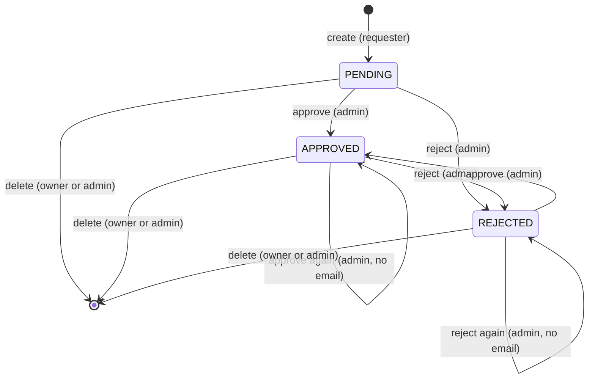

# Leaves module: functional specification

This document describes the behavior of the leaves module of the new
application for developers, testers and the client. It is written from the
implemented code, not from the old system, and replaces the initial
analysis as the reference for the leave rules.

How to read it:

- Every rule names the function or API endpoint that implements it
  (**Implemented by**) and the test file that proves it (**Proven by**).
  The links are relative and checked by `pnpm lint:links` and by the unit
  test [`scripts/functional-spec.spec.mjs`](../scripts/functional-spec.spec.mjs),
  so a moved or deleted file fails CI.
- Code blocks marked "copied from" are literal copies of existing test
  cases. The same unit test checks that each block still occurs verbatim in
  the named test file.
- Spec references such as `PROJECT_REWRITE_SPEC.md:83` point to lines of the
  rewrite specification (`docs/tech-rewrite/`, kept outside the repository).
  Task ids such as LV-01 refer to the implementation specification.
- A pull request that changes a leave rule in `packages/shared/src/` or the
  attendance module must update this document or state that it is not
  affected (pull request template checkbox).

## Contents

1. [Glossary](#1-glossary)
2. [Leave data](#2-leave-data)
3. [Work-day rules](#3-work-day-rules)
4. [Leave types](#4-leave-types)
5. [States and approval flow](#5-states-and-approval-flow)
6. [Delete rules](#6-delete-rules)
7. [Visibility and filters](#7-visibility-and-filters)
8. [Attendance API](#8-attendance-api)
9. [Data migration notes](#9-data-migration-notes)
10. [Changes vs the old system](#10-changes-vs-the-old-system)

## 1. Glossary

| Term | Meaning |
| --- | --- |
| Leave | One absence request of one user: a calendar-date range, a type, a state and a half-day flag. Stored in the `leaves` collection. |
| Calendar date | A date written as `YYYY-MM-DD`, without time or timezone. All leave dates are calendar dates. |
| Working day | Monday to Friday and not a Slovak public holiday ([section 3](#3-work-day-rules)). |
| Work days (`numDays`) | Number of working days a leave covers, minus 0.5 for a half-day. Always computed by the server. |
| Half-day | A leave flagged `isHalfDay`. Allowed only when start and end date are the same day. Counts 0.5 on a working day and 0 on a non-working day. |
| Requester | The user who created the leave. Always the caller of `POST /api/leaves`; it never changes. |
| Approver | The admin who last approved or rejected the leave (`approverId`). Empty (`null`) until the first decision. |
| Admin | An active user with `isAdmin = true`. Only admins approve, reject and delete other users' leaves. |
| States | `PENDING`, `APPROVED`, `REJECTED` ([section 5](#5-states-and-approval-flow)). |
| Types | `ANNUAL`, `SICKNESS`, `DOCTOR`, `MATERNITY`, `PARENTAL`, `CARING` ([section 4](#4-leave-types)). |
| Deactivated user | A user with `active = false`. Cannot sign in; their leaves stay and keep their requester. |
| Anonymized user | A deactivated user whose email and names were replaced by placeholders (GDPR erasure). Their leaves stay. |
| M2M consumer | The external system that reads `GET /api/attendence/:year/:month` with HTTP Basic credentials. |

## 2. Leave data

A leave has these fields. The API returns them as `LeaveDto`; the database
never exposes its internal `_id` / `__v`.

| Field | Type | Set by | Rule |
| --- | --- | --- | --- |
| `id` | string (uuid v4) | server | unique |
| `requesterId` | string (User id) | server = caller | returned as `requester` (`{ id, firstName, surname, active, anonymized }`, no email) |
| `approverId` | string or `null` | server, on approve / reject | returned as `approver`, `null` before the first decision |
| `startDate` | `YYYY-MM-DD` | client | real calendar date |
| `endDate` | `YYYY-MM-DD` | client | real calendar date, not before `startDate` |
| `isHalfDay` | boolean, default `false` | client | `true` only when `startDate === endDate` |
| `type` | `LeaveType`, default `ANNUAL` | client | one of the six codes |
| `state` | `LeaveState`, default `PENDING` | server | one of the three codes |
| `numDays` | number | server | `>= 0`, multiple of 0.5, = work days of the leave ([section 3](#3-work-day-rules)) |
| `createdAt`, `updatedAt` | ISO-8601 timestamp | server | — |

Rules:

- **Dates are calendar dates.** They are stored and returned as `YYYY-MM-DD`
  strings; no timezone conversion happens on input, storage or output.
  Malformed or non-existent dates (`2026-02-30`, `9.11.2026`) are rejected.
  - Implemented by: `isIsoDate` in
    [`packages/shared/src/workdays.ts`](../packages/shared/src/workdays.ts);
    Leave schema in
    [`apps/api/src/leaves/leave.schema.ts`](../apps/api/src/leaves/leave.schema.ts).
  - Proven by: [`packages/shared/src/workdays.spec.ts`](../packages/shared/src/workdays.spec.ts),
    [`apps/api/test/leaves/leave.model.int-spec.ts`](../apps/api/test/leaves/leave.model.int-spec.ts).
- **`numDays` is computed by the server** with `leaveWorkDays` when the leave
  is created. A client that sends `numDays`, `state`, `requesterId`,
  `approverId` or `id` gets 400 `VALIDATION_FAILED`.
  - Implemented by: `POST /api/leaves`, `LeavesService.create` in
    [`apps/api/src/leaves/leaves.service.ts`](../apps/api/src/leaves/leaves.service.ts),
    `CreateLeaveDto` in
    [`apps/api/src/leaves/create-leave.dto.ts`](../apps/api/src/leaves/create-leave.dto.ts).
  - Proven by: [`apps/api/test/leaves/create-leave.int-spec.ts`](../apps/api/test/leaves/create-leave.int-spec.ts),
    [`apps/api/src/leaves/create-leave.dto.spec.ts`](../apps/api/src/leaves/create-leave.dto.spec.ts).
- **A new leave is always `PENDING`, its requester is the caller and its
  approver is empty.** Admins also create leaves only for themselves.
  - Implemented by: `LeavesService.create`.
  - Proven by: [`apps/api/test/leaves/create-leave.int-spec.ts`](../apps/api/test/leaves/create-leave.int-spec.ts).
- **Date rules of every stored leave:** `endDate` must not be before
  `startDate` (`LEAVE_END_BEFORE_START`, message "Start date must not be
  greater than end date"); a half-day must be a single day
  (`LEAVE_HALF_DAY_MULTIPLE_DAYS`, message "Half day option is allowed only
  within single day"). When both fail, `LEAVE_END_BEFORE_START` wins.
  - Implemented by: `leaveDateRuleError` in
    [`packages/shared/src/leaves.ts`](../packages/shared/src/leaves.ts)
    (used by the API, the Leave schema and the migration).
  - Proven by: [`packages/shared/src/leaves.spec.ts`](../packages/shared/src/leaves.spec.ts),
    [`apps/api/test/leaves/leave.model.int-spec.ts`](../apps/api/test/leaves/leave.model.int-spec.ts).
- **Extra limits for new leaves** (create API and add-leave form only; stored
  and migrated leaves are not checked):
  - `startDate` and `endDate` must lie within `2000-01-01`..`2100-12-31`,
    else 400 `VALIDATION_FAILED` with `startDate must be between 2000-01-01
    and 2100-12-31` (or `endDate …`).
  - A leave must be shorter than 2 years: `endDate` must be earlier than
    `startDate` + 2 calendar years, else 400 `LEAVE_TOO_LONG` ("Leave must be
    shorter than 2 years"). A 29 February start maps to 28 February of a
    non-leap target year, so `2026-03-01` may end at the latest on
    `2028-02-29`, and `2028-02-29` at the latest on `2030-02-27`.
  - Precedence when several checks fail: `VALIDATION_FAILED` >
    `LEAVE_END_BEFORE_START` > `LEAVE_TOO_LONG` >
    `LEAVE_HALF_DAY_MULTIPLE_DAYS`.
  - There is no past-date and no overlap restriction. A leave with 0 work
    days (for example a weekend) is allowed and shown as `0`.
  - Implemented by: `leaveDateFieldError`, `leaveEndDateLimit`,
    `newLeaveRuleError` in [`packages/shared/src/leaves.ts`](../packages/shared/src/leaves.ts);
    `assertLeaveDateRules` in
    [`apps/api/src/leaves/create-leave.dto.ts`](../apps/api/src/leaves/create-leave.dto.ts);
    the form in [`apps/web/src/leaves/NewLeavePage.tsx`](../apps/web/src/leaves/NewLeavePage.tsx).
  - Proven by: [`packages/shared/src/leaves.spec.ts`](../packages/shared/src/leaves.spec.ts),
    [`apps/api/src/leaves/create-leave.dto.spec.ts`](../apps/api/src/leaves/create-leave.dto.spec.ts),
    [`apps/api/test/leaves/create-leave.int-spec.ts`](../apps/api/test/leaves/create-leave.int-spec.ts),
    [`apps/web/src/leaves/NewLeavePage.spec.tsx`](../apps/web/src/leaves/NewLeavePage.spec.tsx).
- **The add-leave form shows a live work-day count** with the same shared
  function. It is a preview; the value stored by the server is
  authoritative.
  - Implemented by: [`apps/web/src/leaves/NewLeavePage.tsx`](../apps/web/src/leaves/NewLeavePage.tsx)
    (`leaveWorkDays`).
  - Proven by: [`apps/web/src/leaves/NewLeavePage.spec.tsx`](../apps/web/src/leaves/NewLeavePage.spec.tsx).
- **Every create, approve, reject and delete writes an audit entry** in the
  same transaction as the change (`LEAVE_CREATED`, `LEAVE_APPROVED`,
  `LEAVE_REJECTED`, `LEAVE_DELETED`). If the audit write fails, the change is
  not stored (500 `INTERNAL_ERROR`).
  - Implemented by: `LeavesService` in
    [`apps/api/src/leaves/leaves.service.ts`](../apps/api/src/leaves/leaves.service.ts) and
    [`apps/api/src/audit/audit-details.ts`](../apps/api/src/audit/audit-details.ts).
  - Proven by: [`apps/api/test/leaves/create-leave.int-spec.ts`](../apps/api/test/leaves/create-leave.int-spec.ts),
    [`apps/api/test/leaves/decide-leave.int-spec.ts`](../apps/api/test/leaves/decide-leave.int-spec.ts),
    [`apps/api/test/leaves/delete-leave.int-spec.ts`](../apps/api/test/leaves/delete-leave.int-spec.ts),
    [`apps/api/src/audit/audit-details.spec.ts`](../apps/api/src/audit/audit-details.spec.ts).

## 3. Work-day rules

- **Working day** = Monday to Friday and not a Slovak public holiday.
- **Public holidays** come from the library `date-holidays`, pinned to
  version **3.38.0** in
  [`packages/shared/package.json`](../packages/shared/package.json) and the
  lockfile, country `SK`, holidays of type `public` only. Days that the data
  marks as `observance` are working days. Historic years keep their
  historic rules.
- **Work days of a leave** = number of working days in `[startDate, endDate]`,
  both ends included. When `endDate` is before `startDate`, the result is 0.
- **Half-day rule**: for a half-day leave (start = end) the count is reduced
  by 0.5, but only when the count is above 0. A half-day on a weekend or a
  holiday gives 0, never −0.5. The function itself does not reject a
  multi-day half-day (the API does), so the old multi-day example still
  gives 2.5.
- The calculation uses calendar-date arithmetic only and gives the same
  result in every process timezone.
- Implemented by: `isWorkingDay`, `publicHolidays`, `countWorkingDays`,
  `leaveWorkDays` in
  [`packages/shared/src/workdays.ts`](../packages/shared/src/workdays.ts).
  Used by the create API, the add-leave form, the summary, the attendance
  API and the migration.
- Proven by: [`packages/shared/src/workdays.spec.ts`](../packages/shared/src/workdays.spec.ts)
  (also run under `TZ=UTC` and `TZ=Pacific/Auckland` by `pnpm test:tz`).

### Slovak public holidays

The pinned data changes these days from public holiday to observance
(working day): 1 September (Constitution Day) since 2024, 17 November since
2025, 8 May and 15 September since 2026.

Public holidays of 2026 (pinned by the test "returns exactly the 11 SK
public holidays of 2026"):

| Date | Holiday | Weekday |
| --- | --- | --- |
| 2026-01-01 | Day of the Establishment of the Slovak Republic | Thu |
| 2026-01-06 | Epiphany | Tue |
| 2026-04-03 | Good Friday | Fri |
| 2026-04-06 | Easter Monday | Mon |
| 2026-05-01 | Labour Day | Fri |
| 2026-07-05 | Saints Cyril and Methodius Day | Sun |
| 2026-08-29 | Slovak National Uprising anniversary | Sat |
| 2026-11-01 | All Saints' Day | Sun |
| 2026-12-24 | Christmas Eve | Thu |
| 2026-12-25 | Christmas Day | Fri |
| 2026-12-26 | St. Stephen's Day | Sat |

The client confirms this list as part of this document (WD-01). The years
2024, 2025 and 2027 are pinned by the same test file, so a `date-holidays`
upgrade that changes the Slovak rules fails CI.

### Worked examples

Each row is `[start, end, isHalfDay, expected work days]`. Notable rows:

- `2017-12-07`..`2017-12-11` = 3: Thu, Fri, Mon (weekend skipped).
- `2017-12-22`..`2017-12-30` = 4: 25 and 26 December are holidays, 23, 24
  and 30 December are weekend days.
- `2017-12-11`..`2017-12-13` half-day = 2.5: 3 − 0.5.
- `2026-11-07` half-day = 0: a half-day on a Saturday.
- `2026-04-02`..`2026-04-07` = 2: Good Friday and Easter Monday are holidays.
- `2026-05-08` = 1 but `2025-05-08` = 0: public holiday until 2025,
  observance since 2026.

Copied from [`packages/shared/src/workdays.spec.ts`](../packages/shared/src/workdays.spec.ts):

<!-- literal: ../packages/shared/src/workdays.spec.ts -->
```ts
const examples: Array<
  [start: string, end: string, isHalfDay: boolean, expected: number]
> = [
  ['2017-12-07', '2017-12-11', false, 3],
  ['2017-12-22', '2017-12-30', false, 4],
  ['2017-12-11', '2017-12-13', true, 2.5],
  ['2026-11-04', '2026-11-04', true, 0.5],
  ['2026-11-07', '2026-11-07', true, 0],
  ['2026-11-10', '2026-11-09', false, 0],
  ['2026-04-02', '2026-04-07', false, 2],
  ['2026-12-21', '2026-12-31', false, 7],
  ['2026-05-08', '2026-05-08', false, 1],
  ['2025-05-08', '2025-05-08', false, 0],
  ['2026-09-15', '2026-09-15', false, 1],
  ['2025-09-15', '2025-09-15', false, 0],
  ['2025-11-17', '2025-11-17', false, 1],
  ['2023-11-17', '2023-11-17', false, 0],
  ['2025-09-01', '2025-09-01', false, 1],
  ['2023-09-01', '2023-09-01', false, 0],
];
```

A half-day on a public holiday (Christmas Day 2026, a Friday) gives 0.
Copied from [`packages/shared/src/workdays.spec.ts`](../packages/shared/src/workdays.spec.ts):

<!-- literal: ../packages/shared/src/workdays.spec.ts -->
```ts
  it('never returns -0.5 for a half-day on a non-working day', () => {
    expect(
      leaveWorkDays({
        startDate: '2026-12-25',
        endDate: '2026-12-25',
        isHalfDay: true,
      }),
    ).toBe(0);
  });
```

## 4. Leave types

The API and the database always use the codes. The UI shows the labels in
the selected language (English by default, Slovak switchable); emails always
use the English label. The declaration order below is the display order
(type select, summary rows). The calendar letter is used in calendar event
titles.

| Code | English label | Slovak label | Calendar letter |
| --- | --- | --- | --- |
| `ANNUAL` | Annual leave | Dovolenka | A |
| `SICKNESS` | Sick leave | PN (práceneschopnosť) | S |
| `DOCTOR` | Doctor visit | Návšteva lekára | D |
| `MATERNITY` | Maternity leave | Materská dovolenka | M |
| `PARENTAL` | Parental leave | Rodičovská dovolenka | P |
| `CARING` | Caring for a relative at home | Ošetrovanie člena rodiny (OČR) | C |

State labels:

| Code | English label | Slovak label |
| --- | --- | --- |
| `PENDING` | Pending | Čaká na schválenie |
| `APPROVED` | Approved | Schválená |
| `REJECTED` | Rejected | Zamietnutá |

- A leave without a type is stored as `ANNUAL`. The types are visible to
  every employee.
- Implemented by: `LeaveType`, `LeaveState`, `LEAVE_TYPES`, `LEAVE_STATES`,
  `LEAVE_TYPE_LABELS_EN`, `LEAVE_STATE_LABELS_EN` in
  [`packages/shared/src/leaves.ts`](../packages/shared/src/leaves.ts); keys
  `leaveType.*` and `leaveState.*` in
  [`apps/web/src/i18n/locales/en.json`](../apps/web/src/i18n/locales/en.json)
  and [`apps/web/src/i18n/locales/sk.json`](../apps/web/src/i18n/locales/sk.json);
  the calendar letter (first letter of the code, the same in SK and EN, as
  in the old app) is `LEAVE_TYPE_LETTERS` in
  [`packages/shared/src/calendar.ts`](../packages/shared/src/calendar.ts).
- Proven by: [`packages/shared/src/leaves.spec.ts`](../packages/shared/src/leaves.spec.ts),
  [`packages/shared/src/calendar.spec.ts`](../packages/shared/src/calendar.spec.ts),
  [`apps/web/src/i18n/i18n.spec.ts`](../apps/web/src/i18n/i18n.spec.ts)
  (every code has an EN and SK label, no raw code shown, EN catalog equals
  the email labels).
- The Slovak texts are proposals for client review.

## 5. States and approval flow



Rules:

- **Approve and reject are unrestricted.** Any state may go to `APPROVED` or
  `REJECTED`, including the same state. No action returns a leave to
  `PENDING`. Every accepted call sets `approverId` to the calling admin
  (also on a same-state call) and writes an audit entry with the previous
  and new state. Dates, type, requester and `numDays` never change.
  Concurrent calls: the last write wins.
  - Implemented by: `POST /api/leaves/:id/approve`,
    `POST /api/leaves/:id/reject`; `LeavesService.decide` and
    `applyDecision` in
    [`apps/api/src/leaves/leaves.service.ts`](../apps/api/src/leaves/leaves.service.ts).
  - Proven by: [`apps/api/test/leaves/decide-leave.int-spec.ts`](../apps/api/test/leaves/decide-leave.int-spec.ts).
- **Only admins approve or reject. An admin may decide their own leave.**
  Check order: authentication (401) → admin role (403 `FORBIDDEN`, "Admin
  role required", also for unknown ids) → existence (404
  `LEAVE_NOT_FOUND`, "Leave not found"). The request body is ignored.
  - Implemented by: `@Roles('admin')` on the handlers in
    [`apps/api/src/leaves/leaves.controller.ts`](../apps/api/src/leaves/leaves.controller.ts).
  - Proven by: [`apps/api/test/leaves/decide-leave.int-spec.ts`](../apps/api/test/leaves/decide-leave.int-spec.ts),
    [`apps/api/test/authz/permissions.int-spec.ts`](../apps/api/test/authz/permissions.int-spec.ts).
- **Effect on other features**: the summary and the attendance API count
  `APPROVED` leaves only, so `REJECTED` → `APPROVED` makes a leave count and
  `APPROVED` → `REJECTED` removes it. The calendar hides `REJECTED` leaves
  ([section 7](#7-visibility-and-filters)).
- **Approval screen** `/approval` (admins only): lists all `PENDING` leaves
  (same columns and order as the list) with Approve and Reject; after a
  successful action the row disappears. The navigation shows a "Leaves
  approval" link with a red badge of the pending count, for admins only,
  hidden when the count is 0. On the `/leaves` list, admins get Approve and
  Reject on every row; the button that matches the current state is
  disabled. Non-admins see no link, no buttons, and a "not authorized"
  view at `/approval`. There is no confirmation dialog for approve /
  reject.
  - Implemented by: APR-02 (uses `GET /api/leaves?state=PENDING` and the
    approve / reject endpoints above; no new endpoint);
    [`apps/web/src/approval/ApprovalPage.tsx`](../apps/web/src/approval/ApprovalPage.tsx) (approval page),
    [`apps/web/src/leaves/LeaveDecisionButtons.tsx`](../apps/web/src/leaves/LeaveDecisionButtons.tsx) (Approve / Reject on
    approval and list rows), [`apps/web/src/layout/Layout.tsx`](../apps/web/src/layout/Layout.tsx) (pending badge).
  - Proven by: [`apps/web/src/approval/ApprovalPage.spec.tsx`](../apps/web/src/approval/ApprovalPage.spec.tsx),
    [`apps/web/src/leaves/LeaveDecisionButtons.spec.tsx`](../apps/web/src/leaves/LeaveDecisionButtons.spec.tsx).

Who may do what:

| Action | Owner (user) | Other user | Admin | Unauthenticated / deactivated | M2M credentials |
| --- | --- | --- | --- | --- | --- |
| Create a leave (for self) | ✓ 201 | — | ✓ 201 (for self) | 401 | 401 |
| See all leaves (list, calendar) | ✓ | ✓ | ✓ | 401 | 401 |
| See own summary | ✓ | — | ✓ (own only) | 401 | 401 |
| Approve / reject | 403 | 403 | ✓ 200 (also own leave) | 401 | 401 |
| Delete | ✓ 204 (any state) | 403 | ✓ 204 (any leave) | 401 | 401 |

Proven by: [`apps/api/test/authz/permissions.int-spec.ts`](../apps/api/test/authz/permissions.int-spec.ts)
and the endpoint tests named in this section and in sections 6 and 7.

### Email triggers

All emails are English only and fire-and-forget: they are sent after the
database change committed, and a mail failure (SMTP down, not configured)
never changes the API result; it is only logged.

| Trigger | Recipient | Subject | Not sent when |
| --- | --- | --- | --- |
| Leave created | `APPROVAL_MAIL_RECEIVER` only | `New leave notification` | `APPROVAL_MAIL_RECEIVER` is empty (warn log) or SMTP is not configured |
| Leave approved (state changed) | the requester | `Your leave was approved` | same-state re-approve; requester deactivated or anonymized (info log); the requester's user document is missing; SMTP not configured |
| Leave rejected (state changed) | the requester | `Your leave was rejected` | same-state re-reject; requester deactivated or anonymized; the requester's user document is missing; SMTP not configured |
| Leave deleted | — | — | never sent |

- The new-leave email shows the requester name, the date range formatted as
  `EEEE, MMM d, yyyy` (for example `Monday, Dec 21, 2026`), the English type
  label and a link `BASE_URL/approval`. The decision email shows the dates,
  the type, "Approved by" / "Rejected by" with the admin name and a link
  `BASE_URL/leaves`. Leave dates are calendar dates, so `DEFAULT_TIMEZONE`
  does not shift them. All names are HTML-escaped. A trailing `/` on
  `BASE_URL` is removed; an empty `BASE_URL` gives relative links and a
  startup warning.
- An admin deciding their own leave gets the decision email like any
  requester.
- Implemented by: `renderLeaveCreated`, `renderLeaveDecided`,
  `formatMailDate`, `appUrl`, `isStateChange`, `isReachable`, `shouldNotify`
  in [`apps/api/src/notifications/leave-mail.templates.ts`](../apps/api/src/notifications/leave-mail.templates.ts);
  `LeaveNotificationsService` in
  [`apps/api/src/notifications/leave-notifications.service.ts`](../apps/api/src/notifications/leave-notifications.service.ts).
- Proven by: [`apps/api/src/notifications/leave-mail.templates.spec.ts`](../apps/api/src/notifications/leave-mail.templates.spec.ts),
  [`apps/api/src/notifications/leave-notifications.service.spec.ts`](../apps/api/src/notifications/leave-notifications.service.spec.ts),
  [`apps/api/src/notifications/english-only.spec.ts`](../apps/api/src/notifications/english-only.spec.ts),
  [`apps/api/test/notifications/leave-notifications.int-spec.ts`](../apps/api/test/notifications/leave-notifications.int-spec.ts),
  [`apps/api/test/leaves/decide-leave.int-spec.ts`](../apps/api/test/leaves/decide-leave.int-spec.ts),
  [`apps/api/test/leaves/create-leave.int-spec.ts`](../apps/api/test/leaves/create-leave.int-spec.ts).

## 6. Delete rules

- **The requester deletes their own leave in any state; an admin deletes any
  leave.** Everyone else gets 403 `FORBIDDEN` ("You can delete only your own
  leaves"). An unknown id (also after an earlier delete) gives 404
  `LEAVE_NOT_FOUND`, checked before the ownership check.
- **Delete is a hard delete.** The audit entry `LEAVE_DELETED` keeps a
  snapshot of the deleted leave (requester, dates, type, state, half-day,
  `numDays`). No email is sent.
- Leaves of deactivated and anonymized requesters can be deleted by an admin.
- **UI**: the Delete button is shown only on rows the viewer may delete
  (exactly where the server would not answer 403) and asks for
  confirmation ("Delete leave?") first; Cancel sends no request.
- Implemented by: `DELETE /api/leaves/:id`; `LeavesService.remove` and
  `mayDeleteLeave` in
  [`apps/api/src/leaves/leaves.service.ts`](../apps/api/src/leaves/leaves.service.ts);
  `canDeleteLeave` in
  [`apps/web/src/leaves/leave-permissions.ts`](../apps/web/src/leaves/leave-permissions.ts);
  [`apps/web/src/leaves/DeleteLeaveAction.tsx`](../apps/web/src/leaves/DeleteLeaveAction.tsx).
- Proven by: [`apps/api/test/leaves/delete-leave.int-spec.ts`](../apps/api/test/leaves/delete-leave.int-spec.ts),
  [`apps/web/src/leaves/DeleteLeaveAction.spec.tsx`](../apps/web/src/leaves/DeleteLeaveAction.spec.tsx).

## 7. Visibility and filters

### List

- **Every active user sees every leave of every user**, including the type
  and leaves of deactivated and anonymized requesters (company-wide
  visibility). Optional `?state=PENDING|APPROVED|REJECTED` (exact match);
  any other value gives 400 `VALIDATION_FAILED`.
- **Order**: `startDate` descending, then `createdAt` descending, then `id`
  ascending. No pagination.
- **Names**: `First Surname`; a deactivated user gets the suffix
  `(deactivated)`, after a space (SK `(deaktivovaný)`); a reference to a user document
  that does not exist shows `Deleted <id>` (the API logs a warning). User
  references never carry the email.
- **Days column**: `<start> - <end> (<n> work days)`, `work day` when n = 1,
  `0` shown as `0` (not `?`), half-days with one decimal (`0.5`, SK `0,5`).
- Implemented by: `GET /api/leaves`; `LeavesService.list` in
  [`apps/api/src/leaves/leaves.service.ts`](../apps/api/src/leaves/leaves.service.ts),
  `compareLeavesForList` in
  [`apps/api/src/leaves/leave-order.ts`](../apps/api/src/leaves/leave-order.ts),
  [`apps/api/src/leaves/leave.mapper.ts`](../apps/api/src/leaves/leave.mapper.ts);
  `formatUserName`, `formatUserRef`, `missingUserRef` in
  [`packages/shared/src/users.ts`](../packages/shared/src/users.ts);
  [`apps/web/src/leaves/leave-format.ts`](../apps/web/src/leaves/leave-format.ts),
  [`apps/web/src/leaves/LeavesPage.tsx`](../apps/web/src/leaves/LeavesPage.tsx).
- Proven by: [`apps/api/test/leaves/list-leaves.int-spec.ts`](../apps/api/test/leaves/list-leaves.int-spec.ts),
  [`apps/api/src/leaves/leave-order.spec.ts`](../apps/api/src/leaves/leave-order.spec.ts),
  [`apps/api/src/leaves/leave.mapper.spec.ts`](../apps/api/src/leaves/leave.mapper.spec.ts),
  [`packages/shared/src/users.spec.ts`](../packages/shared/src/users.spec.ts),
  [`apps/web/src/leaves/leave-format.spec.ts`](../apps/web/src/leaves/leave-format.spec.ts),
  [`apps/web/src/leaves/LeavesPage.spec.tsx`](../apps/web/src/leaves/LeavesPage.spec.tsx).

### Filters

- Three multiselect filters on `/leaves`: requester, month, year. They apply
  to both the list and the calendar view. Empty selection = no restriction.
  "Clear filter" empties all three. The filter state lives in memory: it
  survives navigation inside the app and is reset on reload. Filtering runs
  in the browser over all loaded leaves.
- A leave is split into one segment per calendar year (first segment from
  the start month, last segment to the end month, middle years cover all
  months). Year filter: some segment year is selected. Month filter: some
  segment whose year passes the year filter covers a selected month.
  Examples: months [January] matches `2017-12-18`..`2018-01-12`; months
  [December] with years [2018] does not match `2017-12-05`..`2018-01-10`.
- Options: 12 months; requesters = unique requesters of the loaded leaves,
  sorted by display name; years = start and end years of all leaves plus
  the current year, descending (middle years of a multi-year leave are not
  added). A selected option that disappears from the data stays selected
  and matches nothing.
- Implemented by: `splitByYear`, `isMatchingFilter`, `makeMonthOptions`,
  `makeRequesterOptions`, `makeYearOptions` in
  [`packages/shared/src/filters.ts`](../packages/shared/src/filters.ts);
  [`apps/web/src/leaves/LeavesFilters.tsx`](../apps/web/src/leaves/LeavesFilters.tsx),
  [`apps/web/src/leaves/filter-store.ts`](../apps/web/src/leaves/filter-store.ts).
- Proven by: [`packages/shared/src/filters.spec.ts`](../packages/shared/src/filters.spec.ts),
  [`apps/web/src/leaves/LeavesFilters.spec.tsx`](../apps/web/src/leaves/LeavesFilters.spec.tsx).

### Calendar

- The Calendar view of `/leaves` (toggle List | Calendar, List by default,
  the choice kept in memory) shows the filtered leaves as all-day events in
  a month grid with prev / next / today. `REJECTED` leaves are hidden;
  `PENDING` leaves have a 50% transparent background and border (the text
  stays opaque), `APPROVED` ones are opaque.
- Each requester has a stable colour from a 15-colour palette: index =
  FNV-1a 32-bit hash of the user id, modulo 15 (same colour on every device,
  filter and session).
- Event title: `<display name> [1/2 ](<calendar letter>)`, for example
  `Jana Nová (A)` or `Jana Nová 1/2 (D)`. The event covers start to end day
  inclusive. Weeks start on Monday in Slovak and on Sunday in English.
  Clicking an event does nothing.
- Implemented by: `colorIndex` (FNV-1a palette index of the user id) in
  [`packages/shared/src/users.ts`](../packages/shared/src/users.ts);
  `colorForUser`, `leaveColor`, `LEAVE_TYPE_LETTERS` and `toCalendarEvents`
  (REJECTED hidden, exclusive end date, `1/2` half-day marker) in
  [`packages/shared/src/calendar.ts`](../packages/shared/src/calendar.ts);
  rendered by [`apps/web/src/leaves/LeavesCalendar.tsx`](../apps/web/src/leaves/LeavesCalendar.tsx)
  (FullCalendar 7); the view toggle in
  [`apps/web/src/leaves/view-store.ts`](../apps/web/src/leaves/view-store.ts).
- Proven by: [`packages/shared/src/users.spec.ts`](../packages/shared/src/users.spec.ts)
  and [`packages/shared/src/calendar.spec.ts`](../packages/shared/src/calendar.spec.ts)
  (colours, events), [`apps/web/src/leaves/LeavesCalendar.spec.tsx`](../apps/web/src/leaves/LeavesCalendar.spec.tsx)
  (rendering), [`apps/web/src/leaves/LeavesPage.spec.tsx`](../apps/web/src/leaves/LeavesPage.spec.tsx)
  (view toggle).

### Approval screen

- Admins only; lists `PENDING` leaves of all users (see
  [section 5](#5-states-and-approval-flow)). Data source:
  `GET /api/leaves?state=PENDING`, proven by
  [`apps/api/test/leaves/list-leaves.int-spec.ts`](../apps/api/test/leaves/list-leaves.int-spec.ts).
  Screen: [`apps/web/src/approval/ApprovalPage.tsx`](../apps/web/src/approval/ApprovalPage.tsx), proven by
  [`apps/web/src/approval/ApprovalPage.spec.tsx`](../apps/web/src/approval/ApprovalPage.spec.tsx).

### Summary

- **A user sees only their own summary** (admins too). It lists, per year
  (descending, including years between without approved leaves), the work
  days of the user's **`APPROVED`** leaves per type. A leave that crosses a
  year boundary is split, and each year counts only its own part. The
  value is recomputed from the dates with the work-day function, not taken
  from the stored `numDays`. Types are ordered as in [section 4](#4-leave-types);
  a type whose leaves sum to 0 is still listed.
- Worked example (all `APPROVED`): `2017-12-10`..`2017-12-14`,
  `2017-12-27`..`2018-01-05` and `2018-01-10`..`2018-01-14`, all `ANNUAL`,
  give 7 work days in 2018 and 7 in 2017; with the first leave `PENDING`
  and the last `REJECTED` they give 4 in 2018 and 3 in 2017.
- Implemented by: `GET /api/leaves/summary`; `buildLeaveSummary` in
  [`packages/shared/src/summary.ts`](../packages/shared/src/summary.ts);
  [`apps/web/src/summary/SummaryPage.tsx`](../apps/web/src/summary/SummaryPage.tsx).
- Proven by: [`packages/shared/src/summary.spec.ts`](../packages/shared/src/summary.spec.ts),
  [`apps/api/test/leaves/leave-summary.int-spec.ts`](../apps/api/test/leaves/leave-summary.int-spec.ts),
  [`apps/web/src/summary/SummaryPage.spec.tsx`](../apps/web/src/summary/SummaryPage.spec.tsx).

### Deactivated and anonymized users

- Deactivation and anonymization never delete or reassign leaves: they keep
  their `requesterId` / `approverId`, keep counting in the attendance API
  (deactivated users) and stay visible in the list under the user's (placeholder) name with the
  `(deactivated)` suffix.
- Anonymization (admin, irreversible) replaces the email with
  `anonymized-<token>@anonymized.invalid`, the first name with `Anonymized`
  and the surname with `User <token>`, and is blocked while the SSO
  directory still lists the user's email (so attendance output never
  changes).
  Implemented by `POST /api/admin/users/:id/anonymize` in
  [`apps/api/src/users/user-anonymization.service.ts`](../apps/api/src/users/user-anonymization.service.ts); proven by
  [`apps/api/test/users/user-anonymization.int-spec.ts`](../apps/api/test/users/user-anonymization.int-spec.ts).

## 8. Attendance API

`GET /api/attendence/:year/:month` (path spelling kept) returns, for every
user listed in the SSO directory, one record per calendar day of the month
with logged Toggl hours and leave codes. The contract is kept 1:1 with the
old system.

- **Authentication**: HTTP Basic with `M2M_USERNAME` / `M2M_PASSWORD`,
  compared in constant time. Missing or wrong credentials, unset
  credentials or an app Bearer token give 401 with an empty body and no
  `WWW-Authenticate` header. The M2M credentials open no other route.
  - Implemented by: `M2mBasicAuthGuard` in
    [`apps/api/src/attendance/attendance.controller.ts`](../apps/api/src/attendance/attendance.controller.ts),
    [`apps/api/src/attendance/m2m-auth.ts`](../apps/api/src/attendance/m2m-auth.ts).
  - Proven by: [`apps/api/src/attendance/m2m-auth.spec.ts`](../apps/api/src/attendance/m2m-auth.spec.ts),
    [`apps/api/src/attendance/attendance.controller.spec.ts`](../apps/api/src/attendance/attendance.controller.spec.ts),
    [`apps/api/test/attendance/attendance-api.int-spec.ts`](../apps/api/test/attendance/attendance-api.int-spec.ts).
- **Errors**: 400 `{"message":"Month is not a number."}` (checked first) or
  `{"message":"Year is not a number."}`; 500
  `{"message":"Cannot get data from SSO, try again later."}` /
  `{"message":"Cannot get data from Toggl, try again later."}` (no partial
  data); any other failure 500 `{"message":"Internal server error"}`, never
  a hanging request. Month `13` means January of the next year and month
  `0` December of the previous year, but such requests get no leave codes.
  - Implemented by: `parseAttendanceParams` in
    [`apps/api/src/attendance/attendance.controller.ts`](../apps/api/src/attendance/attendance.controller.ts),
    `attendancePeriod` in
    [`apps/api/src/attendance/attendance.assembly.ts`](../apps/api/src/attendance/attendance.assembly.ts),
    [`apps/api/src/attendance/attendance.errors.ts`](../apps/api/src/attendance/attendance.errors.ts).
  - Proven by: [`apps/api/src/attendance/attendance.assembly.spec.ts`](../apps/api/src/attendance/attendance.assembly.spec.ts),
    [`apps/api/test/attendance/attendance-api.int-spec.ts`](../apps/api/test/attendance/attendance-api.int-spec.ts),
    [`apps/api/test/contract/attendance.contract.int-spec.ts`](../apps/api/test/contract/attendance.contract.int-spec.ts).

### Leave codes

- **Only `APPROVED` leaves** produce codes; `PENDING` and `REJECTED` leaves
  never appear.
- **Codes per type**: `ANNUAL` → `D8`, a half-day `ANNUAL` → `D4`;
  `SICKNESS` → `PN`; `DOCTOR` → `L`; `MATERNITY`, `PARENTAL`, `CARING` →
  `I`. The half-day flag matters only for `ANNUAL`.
- **Working days only**: a code is written only on working days
  ([section 3](#3-work-day-rules)); weekends and public holidays stay `''`.
  Only the days of the requested year and month are written, each once.
- **Joining**: several leaves on one day are joined with `", "` in the order
  the leaves were created (`_id` ascending), for example `D4, L`.
- **Matching users**: SSO user → app user by exact, case-sensitive email
  match; deactivated users' leaves still count. Only SSO users with a
  `togglUserId` are listed; Toggl hours and leave codes are read only for
  `employee === '1'`. An employee without `togglUserId` is skipped entirely
  (fixes the old hang).
- **Output keys**: the output is keyed by SSO name; two SSO users with the
  same name collide into one key (later user's data, first user's position),
  as in the old system.
- **Timezone**: leave dates are calendar dates and need no conversion. Toggl
  time entries are assigned to days in `DEFAULT_TIMEZONE` (default
  `Europe/Bratislava`); the server never changes a process-global timezone.
- Implemented by: `leaveCode`, `appendLeaveCode`, `clippedDates`,
  `applyLeaves`, `initDraft`, `keyByName` in
  [`apps/api/src/attendance/attendance.assembly.ts`](../apps/api/src/attendance/attendance.assembly.ts);
  `AttendanceService.build` in
  [`apps/api/src/attendance/attendance.service.ts`](../apps/api/src/attendance/attendance.service.ts);
  `addEntry` in
  [`apps/api/src/attendance/toggl/toggl.client.ts`](../apps/api/src/attendance/toggl/toggl.client.ts).
- Proven by: [`apps/api/src/attendance/attendance.assembly.spec.ts`](../apps/api/src/attendance/attendance.assembly.spec.ts),
  [`apps/api/test/attendance/attendance.int-spec.ts`](../apps/api/test/attendance/attendance.int-spec.ts),
  [`apps/api/src/attendance/toggl/toggl.client.spec.ts`](../apps/api/src/attendance/toggl/toggl.client.spec.ts),
  and the golden response
  [`apps/api/test/contract/attendance/worked-example.2024-03.json`](../apps/api/test/contract/attendance/worked-example.2024-03.json)
  (March 2024: half-day `ANNUAL` and `DOCTOR` on 5 March give `D4, L`;
  `SICKNESS` 8–11 March gives `PN` on 8 and 11, weekend days 9–10 stay
  empty; a `PENDING` leave on 12 March gives nothing).

### Examples

Code per type, full day and half-day. Copied from
[`apps/api/src/attendance/attendance.assembly.spec.ts`](../apps/api/src/attendance/attendance.assembly.spec.ts):

<!-- literal: ../apps/api/src/attendance/attendance.assembly.spec.ts -->
```ts
  const expected: Record<LeaveType, [string, string]> = {
    ANNUAL: ['D8', 'D4'],
    SICKNESS: ['PN', 'PN'],
    DOCTOR: ['L', 'L'],
    MATERNITY: ['I', 'I'],
    PARENTAL: ['I', 'I'],
    CARING: ['I', 'I'],
  };
```

Joining with `", "`. Copied from
[`apps/api/src/attendance/attendance.assembly.spec.ts`](../apps/api/src/attendance/attendance.assembly.spec.ts):

<!-- literal: ../apps/api/src/attendance/attendance.assembly.spec.ts -->
```ts
  it('joins with ", " in call order', () => {
    const day = { logged_time: 0, leave: '' };
    appendLeaveCode(day, 'D8');
    appendLeaveCode(day, 'L');
    appendLeaveCode(day, 'PN');
    expect(day.leave).toBe('D8, L, PN');
  });
```

A half-day `ANNUAL` leave from Thursday to Monday writes `D4` on working
days only. Copied from
[`apps/api/src/attendance/attendance.assembly.spec.ts`](../apps/api/src/attendance/attendance.assembly.spec.ts):

<!-- literal: ../apps/api/src/attendance/attendance.assembly.spec.ts -->
```ts
  it('writes codes only on working days', () => {
    const e = entry(31);
    // Thu 7 – Mon 11 March 2024; 9–10 are the weekend.
    applyLeaves(
      e,
      [
        leave({
          startDate: '2024-03-07',
          endDate: '2024-03-11',
          isHalfDay: true,
        }),
      ],
      march,
    );
    expect(e.days.slice(6, 11).map((d) => d.leave)).toEqual([
      'D4',
      'D4',
      '',
      '',
      'D4',
    ]);
  });
```

A long `MATERNITY` leave queried for January 2025: the 1 January holiday and
weekends stay empty, working days get `I` once. Copied from
[`apps/api/test/attendance/attendance.int-spec.ts`](../apps/api/test/attendance/attendance.int-spec.ts):

<!-- literal: ../apps/api/test/attendance/attendance.int-spec.ts -->
```ts
    const leaves = result.attendence.Long!.days.map((d) => d.leave);
    // 2025-01-01 (holiday), weekends empty; working days exactly 'I'.
    expect(leaves[0]).toBe('');
    expect(leaves[1]).toBe('I'); // Thu 2 Jan
    expect(leaves[3]).toBe(''); // Sat 4 Jan
    expect(new Set(leaves)).toEqual(new Set(['', 'I']));
```

## 9. Data migration notes

Old users and leaves were moved from MongoDB 3.6 by a one-off migration
script (MIG-01). Trips, places and generated files were not migrated.

- **Dates**: the old system stored leave dates as instants (local midnight
  of the requester's browser). Each is converted to the calendar date in
  `DEFAULT_TIMEZONE` (default `Europe/Bratislava`), for example
  `2024-03-10T23:00:00.000Z` → `2024-03-11`. An instant that is not exactly
  local midnight is still converted but reported as a warning
  (`LEAVE_DATE_NOT_LOCAL_MIDNIGHT`).
- **`numDays` is recomputed** with the current work-day function. A value
  that differs from the stored one is reported as info
  (`LEAVE_NUMDAYS_CHANGED`, with old and new value); a leave with 0 work
  days is migrated and reported (`LEAVE_ZERO_WORK_DAYS`).
- **Validation** uses the same rules as the API: `LEAVE_END_BEFORE_START`
  and `LEAVE_HALF_DAY_MULTIPLE_DAYS` are errors (the leave is not
  migrated). The new-leave limits (2000–2100, `LEAVE_TOO_LONG`) are **not**
  applied to old data. A missing type becomes `ANNUAL` (info), a missing
  state becomes `PENDING` (warning); unknown values are errors.
- **Removed users** referenced by leaves become deactivated placeholder
  users `Deleted <id>` with email `<id>@deleted.instea.co`
  (`USER_PLACEHOLDER_CREATED`), so the leaves keep their requester or
  approver. Old pending users (`approved = false`) are migrated as active
  users.
- **Leave order**: leaves are inserted in the old natural order, so several
  leaves on one day keep their old order in the attendance output.
- **Severity**: `error` = record not written; `warning` = written, needs a
  decision during the rehearsal; `info` = written, no decision needed. The
  migration writes no audit entries and sends no emails.
- **Report format**: `report.json` (counts, `findingsByCode`, and one
  finding per record with `severity`, `code`, `collection`,
  `sourceObjectId`, `recordId`, `message`, `details`, `action`),
  `report.md` (human summary without email addresses) and `decisions.csv`
  (`code,recordId,decision,decidedBy,note`, pre-filled with every error and
  warning).
- Implemented by: `migrateLegacy`, `mapUsers`, `placeholderUser`,
  `toCalendarDate` in
  [`apps/api/src/migration/legacy-mapping.ts`](../apps/api/src/migration/legacy-mapping.ts);
  `buildReport`, `renderMarkdown`, `renderDecisionsCsv`, `exitCodeFor` in
  [`apps/api/src/migration/report.ts`](../apps/api/src/migration/report.ts);
  CLI [`apps/api/src/migration/migrate-legacy.ts`](../apps/api/src/migration/migrate-legacy.ts),
  [`apps/api/src/migration/runner.ts`](../apps/api/src/migration/runner.ts).
- Proven by: [`apps/api/src/migration/legacy-mapping.spec.ts`](../apps/api/src/migration/legacy-mapping.spec.ts),
  [`apps/api/src/migration/report.spec.ts`](../apps/api/src/migration/report.spec.ts),
  [`apps/api/src/migration/runner.spec.ts`](../apps/api/src/migration/runner.spec.ts),
  [`apps/api/test/migration/migrate-legacy.int-spec.ts`](../apps/api/test/migration/migrate-legacy.int-spec.ts).

Finding codes in use: errors `USER_MISSING_ID`, `USER_DUPLICATE_ID`,
`USER_INVALID_EMAIL`, `USER_DUPLICATE_EMAIL`, `USER_SCHEMA_INVALID`,
`USER_PLACEHOLDER_INVALID`, `LEAVE_MISSING_ID`, `LEAVE_DUPLICATE_ID`,
`LEAVE_MISSING_REQUESTER`, `LEAVE_USER_SKIPPED`, `LEAVE_INVALID_DATE`,
`LEAVE_INVALID_TYPE`, `LEAVE_INVALID_STATE`, `LEAVE_END_BEFORE_START`,
`LEAVE_HALF_DAY_MULTIPLE_DAYS`, `LEAVE_SCHEMA_INVALID`; warnings
`USER_EMPTY_NAME`, `USER_PLACEHOLDER_CREATED`, `LEAVE_ID_NOT_UUID`,
`LEAVE_STATE_DEFAULTED`, `LEAVE_DATE_NOT_LOCAL_MIDNIGHT`; info
`USER_ISADMIN_DEFAULTED`, `USER_APPROVED_FALSE_ACTIVATED`,
`LEAVE_TYPE_DEFAULTED`, `LEAVE_NUMDAYS_CHANGED`, `LEAVE_ZERO_WORK_DAYS`.

## 10. Changes vs the old system

Fixed bugs and defined changes. Parity behavior that is kept on purpose
(attendance contract quirks, company-wide visibility, hard delete of
leaves) is described in the sections above.

| # | Change | Old behavior | Section | Spec source |
| --- | --- | --- | --- | --- |
| 1 | The server validates date order and the half-day rule | no server validation | [2](#2-leave-data) | `PROJECT_REWRITE_SPEC.md:81` |
| 2 | `numDays` is computed by the server; a client value is rejected | stored as sent by the client | [2](#2-leave-data) | `PROJECT_REWRITE_SPEC.md:83` |
| 3 | New leaves must lie within 2000–2100 and be shorter than 2 years | no limit | [2](#2-leave-data) | `PROJECT_REWRITE_SPEC.md:81` (date validation; the limit itself has no line there: implementation spec LV-01, user decision 2026-11-09) |
| 4 | The add-leave form submits valid input | submit button always disabled | [2](#2-leave-data) | `PROJECT_REWRITE_SPEC.md:84` |
| 5 | Types and states shown with readable EN / SK labels | raw codes | [4](#4-leave-types) | `PROJECT_REWRITE_SPEC.md:79` |
| 6 | Only public SK holidays from refreshed data (`date-holidays` 3.38.0); observances are working days | `date-holidays` 1.2.0 from 2017, any holiday type | [3](#3-work-day-rules) | `PROJECT_REWRITE_SPEC_ANSWERS.md:39` (Q-S9), `PROJECT_REWRITE_SPEC.md:107` |
| 7 | Work days computed on calendar dates, independent of the timezone | browser local time | [3](#3-work-day-rules) | `PROJECT_REWRITE_SPEC.md:108`, `PROJECT_REWRITE_SPEC.md:142`, WD-01 |
| 8 | A 0-work-day leave shows `0`, not `?` | `?` | [7](#7-visibility-and-filters) | `PROJECT_REWRITE_SPEC.md:88`, `PROJECT_REWRITE_SPEC.md:142`, LST-01 |
| 9 | Denied actions return explicit 401 / 403 / 404 errors | silent `null` | [5](#5-states-and-approval-flow), [6](#6-delete-rules) | `PROJECT_REWRITE_SPEC.md:100` |
| 10 | Approve / reject of an unknown id gives 404 | an empty leave with the current time as dates | [5](#5-states-and-approval-flow) | APR-01, `PROJECT_REWRITE_SPEC.md:100` |
| 11 | Approval screen and actions are admin-only on client and server | `/approval` route without guard | [5](#5-states-and-approval-flow) | `PROJECT_REWRITE_SPEC.md:99` |
| 12 | Admins may re-decide a leave from the list (Approve / Reject on every row) | only via the API | [5](#5-states-and-approval-flow) | APR-02 (interview: State pick), `PROJECT_REWRITE_SPEC_ANSWERS.md:11` (Q-S2) |
| 13 | The requester gets an email when the leave is approved or rejected | no email | [5](#5-states-and-approval-flow) | `PROJECT_REWRITE_SPEC.md:156` |
| 14 | The new-leave email shows the readable type, links to `/approval`, says "needs" | raw type code, `/leaves/approval` in production, typo "need" | [5](#5-states-and-approval-flow) | `PROJECT_REWRITE_SPEC.md:112`, NOT-02 |
| 15 | Delete shown only where allowed, with confirmation | Delete on every row, no confirmation | [6](#6-delete-rules) | `PROJECT_REWRITE_SPEC.md:85` |
| 16 | Every create, approve, reject and delete is audited | no audit | [2](#2-leave-data) | `PROJECT_REWRITE_SPEC.md:208`, NFR-06 |
| 17 | The summary counts `APPROVED` leaves only | any state | [7](#7-visibility-and-filters) | `PROJECT_REWRITE_SPEC.md:146` |
| 18 | Summary types in fixed type order | first-seen order | [7](#7-visibility-and-filters) | `PROJECT_REWRITE_SPEC.md:103` (the order itself has no line there: implementation spec SUM-01) |
| 19 | Defined list order (`startDate` desc, `createdAt` desc, `id`) | MongoDB natural order | [7](#7-visibility-and-filters) | `PROJECT_REWRITE_SPEC.md:88` (the order itself has no line there: implementation spec LST-01) |
| 20 | Requester filter options sorted by name | first-appearance order | [7](#7-visibility-and-filters) | `PROJECT_REWRITE_SPEC.md:89` (the sort itself has no line there: implementation spec LST-02) |
| 21 | Calendar colour stable per user (hash of the user id) | first-seen order per session, keyed by email | [7](#7-visibility-and-filters) | `PROJECT_REWRITE_SPEC.md:92`, LST-03 |
| 22 | List, calendar and actions show loading, empty and error states | none | [7](#7-visibility-and-filters) | `PROJECT_REWRITE_SPEC.md:93` |
| 23 | Users are deactivated, not deleted; their leaves keep the requester | hard delete, `Deleted <id>` placeholder | [7](#7-visibility-and-filters) | `PROJECT_REWRITE_SPEC.md:152` |
| 24 | Attendance: an employee without `togglUserId` is skipped | the request hangs | [8](#8-attendance-api) | `PROJECT_REWRITE_SPEC.md:123` |
| 25 | Attendance: leave days checked by year and month | month only | [8](#8-attendance-api) | `PROJECT_REWRITE_SPEC.md:120`, `PROJECT_REWRITE_SPEC.md:142`, ATT-04 |
| 26 | Attendance: unexpected errors and non-finite params give 400 / 500 | hang or `Invalid date` | [8](#8-attendance-api) | `PROJECT_REWRITE_SPEC.md:117`, `PROJECT_REWRITE_SPEC.md:142`, ATT-01 |
| 27 | Attendance: constant-time credential compare; Basic auth only on this route; no CORS headers | `===` compare, Basic guard on all `/api/*`, `Access-Control-Allow-Origin: *` | [8](#8-attendance-api) | `PROJECT_REWRITE_SPEC_ANSWERS.md:27` (Q-S6), ATT-01 |
| 28 | Migration recomputes `numDays`, validates every record and reports findings | — | [9](#9-data-migration-notes) | `PROJECT_REWRITE_SPEC.md:181` |
| 29 | Removed users referenced by leaves become deactivated users | placeholder built on every read | [9](#9-data-migration-notes) | `PROJECT_REWRITE_SPEC.md:182` |

Kept on purpose, confirmed by the client: an admin may approve their own
leave (Q-S1, `PROJECT_REWRITE_SPEC_ANSWERS.md:7`); approve / reject from any
state including the same state (Q-S2, `PROJECT_REWRITE_SPEC_ANSWERS.md:11`);
the requester deletes their own leave in any state (Q-S3,
`PROJECT_REWRITE_SPEC_ANSWERS.md:15`); types visible to everyone (Q-S4,
`PROJECT_REWRITE_SPEC_ANSWERS.md:19`); emails in English only (Q-S10,
`PROJECT_REWRITE_SPEC_ANSWERS.md:43`); attendance keyed by SSO name with
collisions kept (Q-S12, `PROJECT_REWRITE_SPEC_ANSWERS.md:51`); the new-leave
email goes only to `APPROVAL_MAIL_RECEIVER` (Q-S13,
`PROJECT_REWRITE_SPEC_ANSWERS.md:55`).
